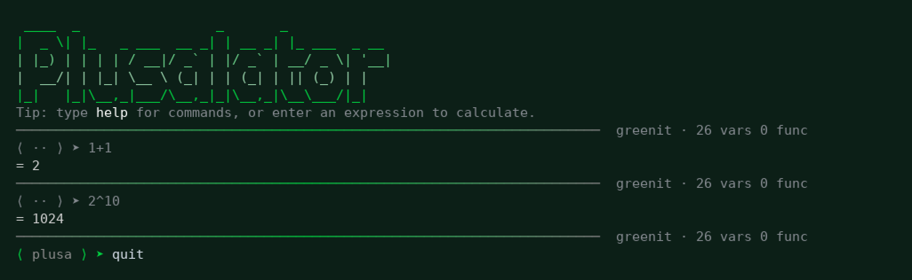

# Plusalator v1.2.0 - Power Tools Edition

Fancy interactive C++17 calculator REPL. Standard library only, single binary.
Engine semantics faithfully modeled on Qalculate (qalc).

[](https://github.com/Mark44928/Plusalator/actions/workflows/ci.yml)



```
⟨ plusa ⟩ ➤ 2+3*4
= 14
⟨ plusa ⟩ ➤ 200+10%
= 220
⟨ plusa ⟩ ➤ f(x)=x^2+1;f(3)
= 10
```

## Build & Install

```
make            # build plusalator
make check      # build + run tests/test.sh + syntax check (gate)
make banner     # regenerate src/banner.h from figlet
make clean
make install    # PREFIX-aware: $PREFIX on Termux, /usr/local on Linux by default
```

**Requirements:**
- C++17 compiler (`clang++` or `g++`)
- `figlet` (only for `make banner`)
  - Termux: `pkg install figlet`
  - Linux: your distro's figlet package

**Paths:**
- Install prefix: honors `$PREFIX` (Termux sets it automatically), otherwise `/usr/local` on Linux
- Temp files: honor `$TMPDIR` (Termux sets it), otherwise `/tmp` on Linux
- History: always saved to `$HOME/.plusalator_history` (capped at 200 entries)
- Config: theme persistence at `$HOME/.config/plusalator/config`

## Engine (Qalculate semantics)

- `%` is postfix **percent** (`50% = 0.5`, `200+10% = 220`). Modulo is `mod(x,y)`.
- `!` postfix factorial (`5! = 120`). `^` right-associative, binds tighter than unary
  (`-2^2 = -4`, `2^3^2 = 512`).
- Implicit multiplication: `2x`, `2(3+4)`, `(2+3)(4+5)`, `2sin(pi/2)`, `3pi`, `x(3)`, `-2x`.
  Never between two numbers (`"2 3"` is a syntax error with a caret).
- Number literals: `0x` hex, `0b` binary, `0o` octal.
- Built-ins (radians by default; `deg`/`rad`/`grad` switch the unit for trig and inverse trig): `sqrt`, `cbrt`, `sin`, `cos`, `tan`, `cot`, `csc`, `sec`, `asin`, `acos`, `atan`,
  `asinh`, `acosh`, `atanh`, `log`, `log2`, `ln`, `exp`, `abs`, `floor`, `ceil`, `round`, `sign`,
  `isprime(x)` (1 if prime), `nextprime(n)`, `prevprime(n)` (the primes strictly after/before n),
  `min`, `max`, `clamp(x, lo, hi)`, `gcd`, `lcm`, `pow(b,e)`, `mod(x,y)`, `hypot(a,b)`,
  `ncr(n,r)` (combinations), `npr(n,r)` (permutations),
  `fact(n)` (factorial as a function form of `!`).
- Constants, grouped and listed by `constants`: geometry (`pi`, `tau`, `phi`), mechanics (`grav`, `G`), thermodynamics (`kB`, `R`, `NA`, `c`, `h`, `hbar`, `sigma`), electromagnetism (`eps0`, `mu0`), atom/masses (`u`, `m_e`, `m_p`, `e`), and `ans` = last result.
- Assignment `x=5`; user functions `f(x)=x^2+1` (body cloned once at definition, depth cap 64,
  graceful "recursion too deep", never a stack crash).
- Errors print a caret under the offending token, exit code 0, never crash/hang (fuzz-gated).

On startup, a dim tip reminds you to type `help` for commands. Type any expression to
calculate immediately. The REPL supports raw-mode line editing on TTYs with full
keyboard navigation, history, and ghost autosuggest.

## Quick commands (no math)

```bash
primes [n]           # print every prime <= n (default 100, capped at 1000)
factorize 360        # or `factors` — prints 360 = 2 × 2 × 2 × 3 × 3 × 5
```

## REPL

- **Raw-mode line editor** on TTYs with full keyboard support; `getline` fallback when stdin is not a TTY
- **Keys:**
  - Navigation: Left/Right/Home/End, Ctrl+A (beginning), Ctrl+E (end)
  - Editing: Backspace/Delete, Ctrl+U (delete to start), Ctrl+K (delete to end)
  - Control: Ctrl+C (clears buffer, never exits), Ctrl+D (quits on empty buffer), Ctrl+L (clear screen + redraw the prompt)
  - Autocomplete: Ctrl+F (accept ghost suggestion)
- **Prefix history:** Up/Down cycle history entries starting with the current buffer prefix (empty buffer = full history)
- **Ghost autosuggest** (fish-style): dim history suffix after the cursor; accept with Right (at end) or Ctrl+F
- **Bracketed paste:** inserted literally, never auto-executes
- **Transient prompt:** full ornament `⟨ plusa ⟩ ➤` on the active line only; after Enter the line redraws
  dim `⟨ ·· ⟩ ➤ <input>`; Ctrl+C clear shows a dim transient prompt with a short dim rule above

## Prompt & Visuals

**NEW:** Completely revamped visual experience with 12 additional modern themes inspired by popular color schemes (Nord, Catppuccin, Tokyo Night, Dracula, Gruvbox, Solarized, Cyberpunk, Matrix, Sunset, Aurora, Neon, Retro) — 18 in total. The banner now features a sophisticated multi-gradient color transition, and the status line shows both variable and function counts for better context.

- **Line 1:** full-width `─` gradient rule (hint→accent→hint) with right-side dim status
  showing `theme · N vars · M funcs`, printed each cycle
- **Active prompt:** `⟨ plusa ⟩ ➤` — U+27E8/27E9 brackets in accent color, `plusa` in hint
  italic, U+27A9 arrow in accent+bold; flashes rose once on error
- **Result:** `= <value>`, bold number, 12 significant figures, trailing zeros trimmed, integers bare
- **Error:** caret line under the offending token; next prompt glyph flashes rose once
- **Banner:** embedded figlet output, rows colored with a top→bottom gradient at runtime
- **Themes:** 18 built-in truecolor themes (6 hex colors each: prompt/result/error/hint/rule/accent):
  - **greenit** (default) — vibrant green on dark background
  - **mono** — clean monochrome grayscale
  - **ocean** — bright blue/cyan palette
  - **ember** — warm orange/red tones
  - **sakura** — soft pink/purple aesthetic
  - **midnight** — deep blue/purple night theme
  - **nord** — Arctic Ice Studio frost palette, low saturation, high readability
  - **catppuccin** — pastel colors, cozy aesthetic
  - **tokyonight** — dark theme with vibrant blue/purple accents
  - **dracula** — popular dark theme with purple accent
  - **gruvbox** — retro groove with warm earth tones
  - **solarized** — scientific, colorblind-friendly palette
  - **cyberpunk** — neon aesthetic with cyan/blue glow
  - **matrix** — classic green-on-black hacker look
  - **sunset** — warm orange/pink gradient
  - **aurora** — purple/blue/pink palette
  - **neon** — bright glowing colors
  - **retro** — CRT monitor aesthetic (amber on dark)
- **Theme commands:** `theme` lists themes with color swatches; `settings` provides interactive
  menu to switch theme and saves to `$HOME/.config/plusalator/config` for persistence
- **Color control:** `NO_COLOR` environment variable or `TERM=dumb` strips all ANSI formatting

## Commands

| Command | Description |
|---------|-------------|
| `<expr>` | Evaluate an expression |
| `help` | Show help box (boxed two-column layout) |
| `vars` | List all variables and their values |
| `funcs` | List user-defined functions with signatures |
| `history` | Show command history |
| `clear` | Clear screen and re-banner |
| `theme` | List available themes with color swatches |
| `settings` | Interactive settings menu (switch theme) |
| `ans` | Show last answer |
| `ms <expr>` | **new** — store an expression into memory |
| `mr` | **new** — recall memory (feeds `ans` so it chains) |
| `m+ <expr>` / `m- <expr>` | **new** — add / subtract from memory |
| `mc` | **new** — clear memory |
| `deg` / `rad` / `grad` | **new** — angle unit for trig and inverse trig |
| `mode <dec\|hex\|bin\|sci>` | **new** — output radix (hex/bin apply to integers) |
| `constants` | List built-in constants (pi, tau, e, phi) |
| `reset` | Clear user variables and functions |
| `del <name>` | Delete a variable or function |
| `config` | Show config path and active theme |
| `version` / `about` | Show version and build info |
| `quit` / `exit` / `q` | Exit the REPL |

All commands are case-sensitive. Assigning over a built-in constant (`pi=5`)
is rejected — built-in definitions win over user assignment.

### v1.2.0 notes

- Memory, angle unit and output radix persist in `~/.config/plusalator/config`
  and are restored on the next launch.
- `mode hex` / `mode bin` format integers as `0xff` / `0b101`; non-integers
  always stay decimal so no precision is lost. `mode sci` switches every result
  to scientific notation.
- The status line shows the active angle unit (`· deg`), radix (`· hex`) and
  memory presence (`· M`) next to the theme name.
- A no-argument command followed by more text is evaluated as an expression:
  `ans * 2` multiplies the last answer instead of being swallowed by `ans`.
- Bare-number display law enforced: results never leak exponent notation for
  readable magnitudes (`0.000001`, not `1e-06`), integers print in full
  (`100000000000000000000`, not `1e+20`), and `-0` prints as `0`.

## Command-line Usage

### `--eval` mode

Headless evaluation for scripting:
```bash
plusalator --eval "2+3*4"        # prints: 14
plusalator --eval "sqrt(16)"     # prints: 4
plusalator --eval "1/0"          # prints error with caret, exit code 0
```

**Flags:**
- `--eval <expr>`: evaluate expression and print bare result (no prompt/banner/color)
- `--version`: show version
- `--help`: show usage

**Environment variables:**
- `FORCE_COLOR=1`: force ANSI color output in `--eval` mode
- `NO_COLOR`: disable all ANSI color output
- `TERM=dumb`: disable all ANSI formatting
- `PREFIX`: installation prefix (Termux sets automatically)
- `TMPDIR`: temporary directory (Termux sets automatically)

All modes exit with code 0, even on calculation errors.

## File layout

- `src/calc.h` / `src/calc.cpp` — tokenizer, AST, parser, evaluator
- `src/lineedit.h` / `src/lineedit.cpp` — raw-mode line editor
- `src/banner.h` — embedded figlet output (dev-generated via `make banner`)
- `src/main.cpp` — REPL loop, commands, prompt, themes
- `Makefile`, `tests/test.sh`, `README.md`, `LICENSE`

## TTY limits (honest)

The line editor, ghost autosuggest, transient prompt, and bracketed paste require a
TTY and are not testable via `--eval`. When stdin is not a TTY, `getline` is used
instead, so history/editing features are unavailable. UTF-8 cursor movement is by byte
(adequate for ASCII calc input); very long lines do not wrap. Screen size is detected
via `TIOCGWINSZ` (falls back to 80 columns).

## License

MIT. See `LICENSE`.
